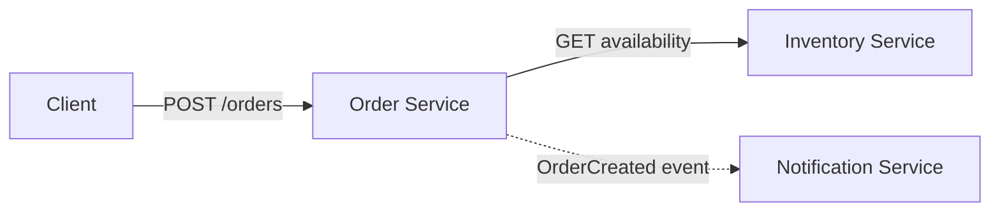
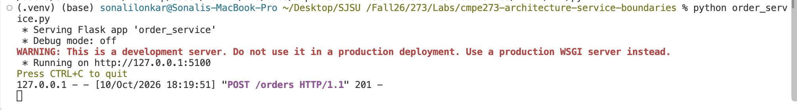
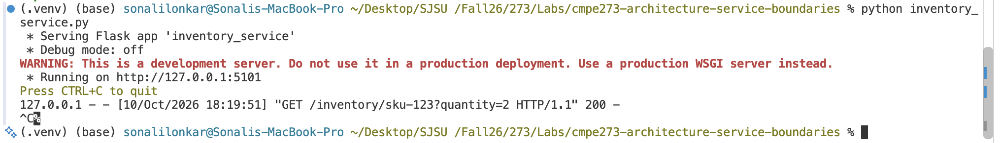
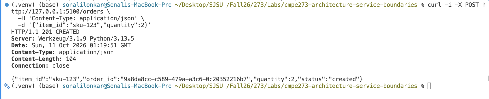
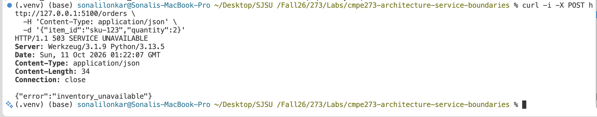
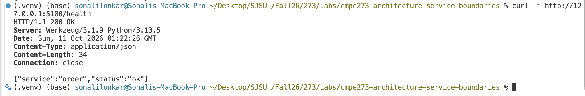
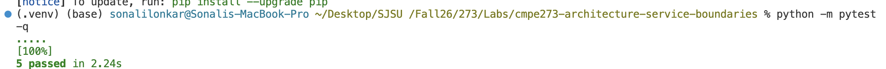

# CMPE 273 — Architecture & Service Boundaries

This project models a small online store with separate Order, Inventory, and Notification responsibilities. The implemented service interaction is:

```text
Order Service → Inventory Service
```

Order and Inventory run as independent processes and communicate over HTTP/JSON. Inventory uses in-memory sample data.

## Architecture



### Component responsibilities and data ownership

| Component | Responsibility | Owned data |
|---|---|---|
| Order Service | Validates order requests, checks Inventory, creates order results, and handles dependency failures | Order ID, item ID, quantity, and order status |
| Inventory Service | Answers availability queries using current item quantities | Item IDs and available quantities |
| Notification Service | Represents confirmation delivery after an order is created | Recipient, notification status, delivery attempts, and delivery result |
| Client | Submits an order and receives the result | No business data owned by this application |

### Service boundaries

Each service owns one business capability and its associated data. Order does not directly read or modify Inventory data; it uses the Inventory API, keeping data ownership explicit. Notification is separated because notification delivery has different retry and reliability concerns from order creation. These boundaries allow services to evolve, deploy, and scale independently while making dependency failures visible and manageable.

## Command, Query, and Event classification

| Interaction | Classification | Explanation |
|---|---|---|
| Check whether an item is available | Query | It requests information from Inventory without changing state. |
| Create an order | Command | It requests a state-changing operation and creates an order result. |
| Order was created | Event | It represents a fact that already happened and can be consumed by Notification. |

## Implemented services

### Order Service

`order_service.py` exposes `POST /orders`. It validates the request and calls Inventory with a 0.5-second timeout.

- Available quantity: `201 Created`
- Requested quantity unavailable: `409 Conflict`
- Inventory stopped or unreachable: `503 Service Unavailable`
- Inventory response too slow: `504 Gateway Timeout`

### Inventory Service

`inventory_service.py` exposes `GET /inventory/<item_id>?quantity=<quantity>` and owns the sample inventory data:

```text
sku-123: 7 units
sku-456: 0 units
sku-789: 12 units
```

## Execution evidence

The services were executed independently at:

- Order Service: `127.0.0.1:5100`
- Inventory Service: `127.0.0.1:5101`

The service startup logs confirm that both Flask processes were running independently.





### Successful order creation

A request for two units of `sku-123` returned `HTTP/1.1 201 CREATED`. The response included an order ID, item ID, quantity, and `created` status.



Observed response:

```text
HTTP/1.1 201 CREATED
{"item_id":"sku-123","order_id":"9a8da8cc-c589-479a-a3c6-0c20352216b7","quantity":2,"status":"created"}
```

### Inventory dependency failure

Inventory was stopped while Order remained running. A subsequent order request returned `HTTP/1.1 503 SERVICE UNAVAILABLE` with `inventory_unavailable`.



Observed response:

```text
HTTP/1.1 503 SERVICE UNAVAILABLE
{"error":"inventory_unavailable"}
```

### Order remains available after failure

After the Inventory failure, the Order health endpoint returned `HTTP/1.1 200 OK`. This demonstrates that the Order process handled the dependency failure without crashing.



Observed response:

```text
HTTP/1.1 200 OK
{"service":"order","status":"ok"}
```

## Automated verification

The test suite covers Inventory queries, successful order creation, unavailable items, Inventory connection failure, and Inventory timeout handling.

```text
5 passed in 2.24s
```



## Reflection

Clear service boundaries allow each service to own and protect its business data without hidden coupling. Data ownership prevents multiple services from independently modifying the same state and producing inconsistent results. Explicit service contracts make dependency failures and recovery behavior easier to reason about. These boundaries allow services to change, deploy, and scale independently while preserving predictable interactions.

## Repository contents

- `order_service.py` — Order service and Inventory client
- `inventory_service.py` — Inventory service and sample inventory data
- `tests/test_services.py` — automated service and failure tests
- `requirements.txt` — runtime dependencies
- `requirements-dev.txt` — test dependency
- `04_order_service_running.png` — Order startup evidence
- `05_inventory_service_running.png` — Inventory startup evidence
- `03_successful_order_creation_201.png` — successful order evidence
- `02_inventory_failure_503.png` — dependency failure evidence
- `01_order_health_after_inventory_failure.png` — Order recovery evidence
- `06_automated_tests_passed.png` — test evidence

